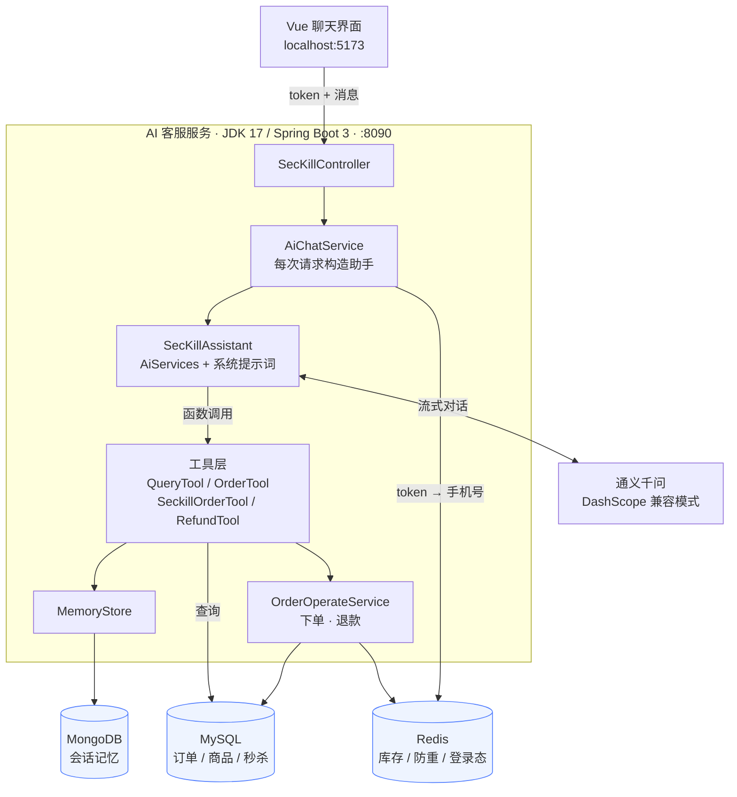
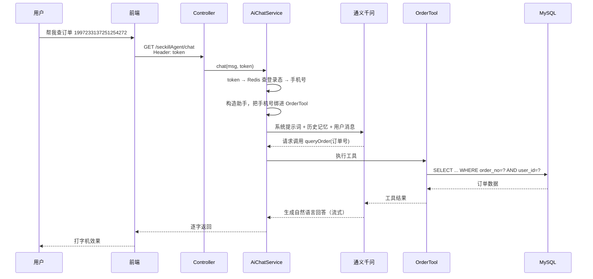

# 秒杀商城 · AI 智能客服

基于 **LangChain4j** 的智能客服服务，作为秒杀商城的 AI 能力补充，**独立部署**。

支持多轮对话、业务查询（商品 / 库存 / 订单）和业务办理（下单 / 退款），
并且具备**身份隔离**与**写操作二次确认**机制。

---

## 功能特性

### 对话能力

- 多轮对话，会话记忆持久化到 MongoDB
- 流式输出，逐字返回
- 会话隔离：按登录用户区分，用户之间互不可见
- 支持主动清空会话

### 业务能力（工具调用）

大模型通过函数调用自主决定使用哪个工具，无需前端传参。

| 工具 | 说明 | 数据来源 |
| --- | --- | --- |
| 查场次商品 | 查询 10 / 12 / 14 点场次的秒杀商品 | MySQL（跨库 JOIN） |
| 查实时库存 | 查询某件秒杀商品的实时剩余库存 | Redis |
| 查商品详情 | 按商品 ID 查询参数、规格、描述 | MySQL |
| 查订单 | 按订单号查询状态、商品、金额（仅限本人） | MySQL |
| 秒杀下单 | 帮用户抢购指定商品，含防重与库存扣减 | MySQL + Redis |
| 申请退款 | 两段式确认后执行退款，并回补库存 | MySQL + Redis |

### 安全设计

| 措施 | 说明 |
| --- | --- |
| 身份服务端注入 | 用户身份由服务端从 token 解析，**不经过大模型**，模型无法伪造 |
| 越权防护 | 订单查询 SQL 强制带 `user_id` 条件，查不到别人的订单 |
| 写操作二次确认 | 退款必须先 `prepareRefund` 再由用户确认，模型不能一步执行 |
| 幂等保护 | 退款 SQL 带 `AND status = 1`，重复调用影响 0 行，不会退两次钱 |
| 防重复抢购 | 复用原系统的 `seckillUniqueOrderset` 集合 |
| 异常兜底 | 全局异常处理，不向前端暴露堆栈 |

---

## 技术栈

| 层 | 选型 |
| --- | --- |
| AI 框架 | LangChain4j 1.0.0-beta3 |
| 大模型 | 通义千问（DashScope OpenAI 兼容模式） |
| Web 框架 | Spring Boot 3.2.6 / JDK 17 |
| 会话记忆 | MongoDB |
| 业务数据 | MySQL 5.7（`s-seckill` / `s-product`） |
| 缓存 | Redis（库存、防重、登录态） |
| 前端 | Vue 3 + Vite |

---

## 架构

### 系统架构



### 一次对话的完整链路

以「帮我查订单 1997233137251254272」为例：



---

## 快速开始

### 环境要求

| 依赖 | 说明 |
| --- | --- |
| JDK 17 | 必须，Spring Boot 3 的最低要求 |
| MySQL 5.7 | 需要 `s-seckill`、`s-product` 两个库 |
| Redis | 默认 `127.0.0.1:6379` |
| MongoDB | 默认 `127.0.0.1:27017` |
| Node.js 18+ | 跑前端需要 |

### 1. 配置

`src/main/resources/application.properties`：

```properties
server.port=8090

# 大模型：通义千问（DashScope OpenAI 兼容模式）
langchain4j.open-ai.streaming-chat-model.base-url=https://dashscope.aliyuncs.com/compatible-mode/v1
langchain4j.open-ai.streaming-chat-model.model-name=qwen3.7-plus
langchain4j.open-ai.streaming-chat-model.api-key=${DASHSCOPE_API_KEY:}

# 会话记忆
spring.data.mongodb.uri=mongodb://localhost:27017/chat_memory_db
chat.memoryMax=20

# 业务库（默认库设为 s-seckill，跨库查 s-product 在 SQL 里写全名）
spring.datasource.url=jdbc:mysql://localhost:3306/s-seckill?useUnicode=true&characterEncoding=UTF-8&serverTimezone=Asia/Shanghai&useSSL=false
spring.datasource.username=root
spring.datasource.password=root

# 缓存
spring.data.redis.host=127.0.0.1
spring.data.redis.port=6379
```

**api-key 通过环境变量注入**，不要写进文件：

```powershell
$env:DASHSCOPE_API_KEY = "你的密钥"
```

（IDEA 里也可以配在 Run Configuration 的 Environment variables 中。）

### 2. 准备测试登录态

当前没有接入登录服务，测试时手动往 Redis 塞一条用户登录态：

```bash
redis-cli SET userToken:test-token-123 "{\"phone\":13088889999,\"nickName\":\"test\"}"
```

### 3. 启动后端

直接运行 `secKillAI.Application`，或者：

```bash
mvn spring-boot:run
```

启动后访问 `http://localhost:8090`。

### 4. 启动前端

```bash
cd D:\IdeaCode\workspace\AIChatFront
npm install
npm run dev
```

浏览器打开 `http://localhost:5173`，在右上角填入上面的 token 即可开始对话。

---

## 接口说明

| 接口 | 方法 | 参数 | 说明 |
| --- | --- | --- | --- |
| `/seckillAgent/chat` | GET | `msg`（query）、`token`（header） | 流式对话，返回 `Flux<String>` |
| `/seckillAgent/session/clear` | POST | `token`（header） | 清空当前用户的会话记忆 |

请求示例：

```bash
curl "http://localhost:8090/seckillAgent/chat?msg=你好" -H "token: test-token-123"
```

> 注意：`msg` 里的中文需要 URL 编码，用 Apifox / Postman 会更方便。

---

## 关键设计说明

### 1. 为什么做成独立服务

原秒杀系统是 **JDK 8 + Spring Boot 2.3**，而 LangChain4j 需要 JDK 17。
AI 客服不参与下单主链路，独立部署对它没有影响，所以直接做成独立服务：
**共享同一套 MySQL 和 Redis，但不改动原系统任何代码。**

### 2. 身份注入：token 不经过大模型

工具类**不加 `@Component`**，而是每次请求由服务端 `new` 出来，构造时把当前用户的手机号绑进去：

```java
AiServices.builder(SecKillAssistant.class)
        .tools(queryTool,
               new OrderTool(orderInfoMapper, phone),
               new SeckillOrderTool(orderOperateService, phone),
               new RefundTool(orderOperateService, phone))
        .build();
```

这样模型**看不到 token，也无法伪造身份**——它只能填业务参数（订单号），
身份由服务端决定。加上 SQL 里的 `AND user_id = ?`，越权查询直接被数据库挡住。

### 3. 退款为什么是两步

退款会改动资金相关的数据，不能让它一步到底。流程是：

```
用户：帮我退掉订单 xxx
  → 模型调用 prepareRefund(orderNo)：校验归属、校验状态必须是「已支付」
  → 服务端把待退订单暂存到 Redis（key: ai:refund:pending:{userId}，5 分钟有效）
  → 模型把确认信息念给用户

用户：确认
  → 模型调用 confirmRefund()：不需要参数
  → 服务端从 Redis 取出待退订单，二次校验后执行
```

`confirmRefund()` **刻意不接收任何参数**——待退哪一单由服务端决定，
模型既不能指定订单，也没有凭证可以伪造。

而 `markRefunded` 的 SQL 带着 `AND status = 1`，即使被重复调用也只会生效一次：

```sql
UPDATE t_order_info SET status = 4, pay_date = NOW()
WHERE order_no = #{orderNo} AND user_id = #{userId} AND status = 1
```

### 4. 会话记忆与隔离

- 记忆存在 MongoDB，一个用户一条文档，`_id` 就是 memoryId
- memoryId 由服务端生成：`token → Redis userToken:{token} → 手机号`
- 每个用户保留最近 20 条消息（`MessageWindowChatMemory` 自动裁剪）
- 前端只传 token 和消息，**不参与决定"这是谁的会话"**

### 5. 下单的一致性处理

秒杀是「缓存预扣 + 落库」的经典模式，这里做了同样的处理：

1. 检查 `seckillUniqueOrderset:{time}`，防止重复抢购
2. Redis 库存 `-1`（快速失败，扛并发）
3. MySQL 扣库存，影响 0 行说明已售罄，回滚 Redis
4. 写入订单（状态 0 = 待支付）
5. 加入防重集合

> 与原系统的差异：原系统通过 RocketMQ 异步建单、WebSocket 通知结果，
> 这里做成了同步实现，保证交互上能立刻拿到订单号。

---

## 项目结构

```
src/main/java/secKillAI
├── assistant/     SecKillAssistant        助手接口（系统提示词 + 记忆）
├── config/        SecKillAgentConfig      会话记忆工厂
├── DTO/                                   订单、商品等数据对象
├── handler/       GlobalExceptionHandler  全局异常兜底
├── mongo/                                 会话记忆的实体与存储实现
├── tools/                                 大模型可调用的工具
│   ├── QueryTool          查商品 / 库存 / 详情
│   ├── OrderTool          查订单
│   ├── SeckillOrderTool   下单
│   └── RefundTool         退款（两段式）
└── web/
    ├── controller/                        对外接口
    ├── mapper/                            数据库访问
    └── service/                           业务逻辑
```

---

## 已知限制

| 限制 | 说明 |
| --- | --- |
| 下单是同步实现 | 原系统走 MQ 异步建单，这里是同步模拟 |
| 没有真实支付 | 测试时需要手动把订单状态改成已支付，才能测退款 |
| 登录态靠手动注入 | 未接入 uaa 服务，测试 token 需要手动写入 Redis |
| 会话不支持多轮会话列表 | 一个用户固定一个会话（可清空重开） |
| Redis 版本要求 | 使用了 `HINCRBY` 等基础命令，兼容 Redis 3.2 |
